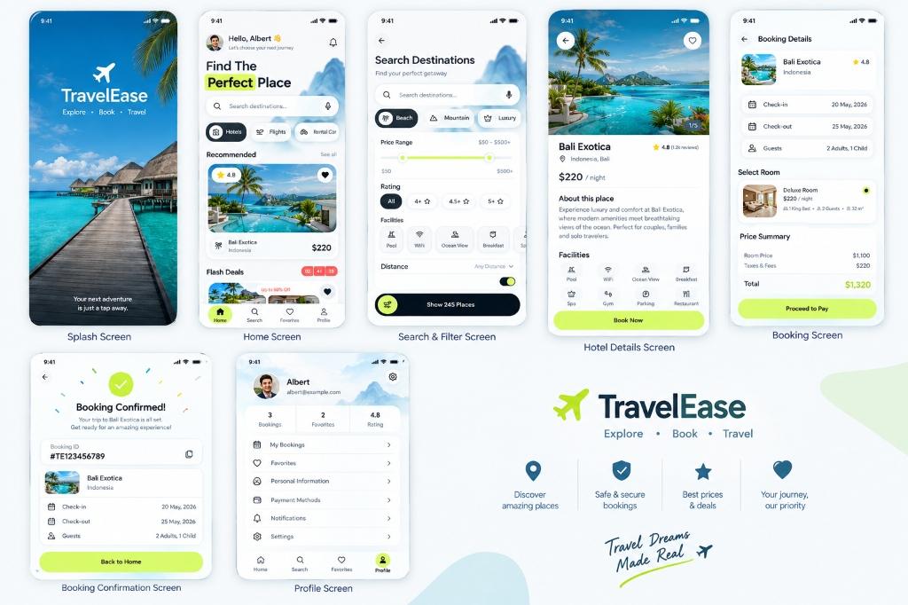
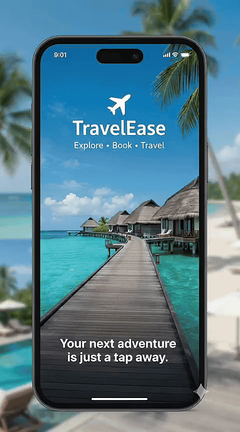

<div align="center">

  

  <br /> <br />

  # ✈️ TravelEase
  ### *Explore • Book • Travel — Next-Generation Travel & Hotel Booking Experience*

  <p align="center">
    <strong>A high-performance, beautifully designed travel discovery and booking mobile application crafted with Flutter 3 and Material Design 3.</strong>
  </p>

  <p align="center">
    <a href="https://flutter.dev"></a>
    <a href="https://dart.dev"></a>
    <a href="LICENSE"></a>
    
    
  </p>

  <p align="center">
    <a href="#-features">Features</a> •
    <a href="#-live-video-demo">Live Demo</a> •
    <a href="#-screen-gallery">Screens</a> •
    <a href="#-design-system--palette">Design System</a> •
    <a href="#-project-architecture">Architecture</a> •
    <a href="#-getting-started">Getting Started</a> •
    <a href="#-roadmap">Roadmap</a>
  </p>

</div>

---

## 📖 Overview

**TravelEase** transforms how travelers discover, plan, and book luxury getaways worldwide. Built from the ground up using **Flutter**, TravelEase combines high-frame-rate fluid animations, modern typography, and a tailored color palette featuring energetic electric lime accents (`#C6F52B`) paired with sleek dark obsidian surfaces (`#0F172A`).

From the immersive splash screen to effortless destination filtering, rich photo galleries, transparent price breakdown, and one-tap reservation confirmation with unique booking receipts—TravelEase delivers an exceptional user journey designed for modern mobile travelers.

---

## 🎬 Live Video Demo

Experience TravelEase in motion. Watch the seamless discovery, dynamic multi-attribute filter slider, room selection, and checkout flow in real time.

<div align="center">

  <table>
    <tr>
      <th align="center">🎥 Full HD Video Walkthrough</th>
      <th align="center">⚡ Quick Animated Preview</th>
    </tr>
    <tr>
      <td align="center" width="55%">
        <video src="assets/Demo.mp4" controls width="100%" style="border-radius: 12px; box-shadow: 0 10px 25px rgba(0,0,0,0.15);">
          Your browser does not support the video tag.
        </video>
        <br /><br />
        <a href="assets/Demo.mp4">
          
        </a>
      </td>
      <td align="center" width="45%">
        
        <br /><br />
        <em>Real-time in-app interactions & transitions</em>
      </td>
    </tr>
  </table>

</div>

---

## 🌟 Core Features

| Feature | Description | Highlight |
| :--- | :--- | :--- |
| 🏝️ **Curated Stays** | Handpicked luxury villas, beach resorts, and mountain hideaways. | High-res imagery & verified review scores |
| ⚡ **Flash Deals** | Exclusive, time-limited discounts up to 50% off with live countdown timer. | Dynamic live ticker `02:45:38` |
| 🔍 **Smart Multi-Param Filter** | Granular filtering by category (Beach, Mountain, Luxury), price slider, and stars. | Interactive `$50 - $500+` slider |
| 🛎️ **Facility Checklists** | Quickly filter and inspect amenities including WiFi, Pool, Spa, Breakfast, and Ocean View. | Multi-select chips & facility icons |
| 🛏️ **Room Selection & Specs** | Detailed room cards showing king/queen bed configurations, max occupancy, and area. | Dimension & guest capacity tags |
| 💳 **Transparent Checkout** | Clear calculation of nightly rates, local taxes, and service fees with no surprises. | Itemized summary table |
| 🧾 **Instant Confirmation** | Generates verifiable booking credentials with one-tap clipboard copy. | Unique reference `#TE123456789` |
| 👤 **Traveler Hub** | Complete personal profile displaying bookings history, wishlist, and account settings. | Multi-tab traveler metrics |

---

## 📱 Screen Gallery

The application includes seven bespoke screens designed with consistent design tokens and micro-interactions:

```
┌─────────────────┐   ┌─────────────────┐   ┌─────────────────┐   ┌─────────────────┐
│  Splash Screen  │──>│   Home Screen   │──>│ Search & Filter │──>│  Hotel Details  │
└─────────────────┘   └─────────────────┘   └─────────────────┘   └─────────────────┘
                                                       │
                                                       ▼
┌─────────────────┐   ┌─────────────────┐   ┌─────────────────┐
│ Profile Screen  │<──│Confirmation Page│<──│ Booking Screen  │
└─────────────────┘   └─────────────────┘   └─────────────────┘
```

1. **Splash Screen**
   - High-impact tropical resort backdrop with wooden pier and ocean vistas.
   - Distinctive TravelEase flight insignia and welcoming value proposition.
2. **Home Screen**
   - Personalized traveler greeting (`Hello, Albert 👋`).
   - Quick category pills: **Hotels**, **Flights**, and **Rental Cars**.
   - Featured recommended spotlight (`Bali Exotica` at `$220/night`, 4.8 ★).
   - Horizontal flash deals slider with active discount timer.
3. **Search & Filter Screen**
   - Destination categories: **Beach**, **Mountain**, **Luxury**.
   - Smooth continuous dual-range price slider from `$50` to `$500+`.
   - Rating filter pills (`All`, `4+`, `4.5+`, `5★`) and amenity checklists.
   - Distance toggle with reactive counter button (`Show 245 Places`).
4. **Hotel Details Screen**
   - Edge-to-edge photo carousel with page indicators (`1/5`) and favorite toggle.
   - Property specs, pricing, and expansive description.
   - Amenities grid: *Pool, WiFi, Ocean View, Breakfast, Spa, Gym, Parking, Restaurant*.
   - Prominent bottom action bar with lime CTA button (`Book Now`).
5. **Booking Screen**
   - Summary card of chosen property with check-in and check-out dates.
   - Guest headcount adjustment (e.g., `2 Adults, 1 Child`).
   - Room configuration selection (e.g., `Deluxe Room`, `32 m²`, `1 King Bed`).
   - Transparent price calculation (Room: `$1,100`, Taxes: `$220`, Total: `$1,320`).
6. **Booking Confirmation Screen**
   - Animated emerald success checkmark banner.
   - Unique generated reservation identifier `#TE123456789` with copy-to-clipboard action.
   - Quick itinerary snapshot and direct navigation back to home.
7. **Profile Screen**
   - User identity header with customizable avatar and email.
   - Metric cards: **3 Bookings**, **2 Favorites**, **4.8 Rating**.
   - Navigation options for *My Bookings, Favorites, Payment Methods, Notifications, Settings*.

---

## 🎨 Design System & Palette

TravelEase utilizes a custom design language combining high-contrast lime highlights with deep slate tones for readability and modern visual appeal:

| Token Name | Hex Code | Preview | Role / Application |
| :--- | :---: | :---: | :--- |
| **Primary Lime** | `#C6F52B` |  | Primary action buttons, badges, active states |
| **Lime Accent Dark** | `#AEDC1C` |  | Pressed states, borders, subtle contrasts |
| **Dark Navy / Obsidian** | `#0F172A` |  | Primary headings, filter buttons, icons |
| **Muted Slate** | `#64748B` |  | Subtitles, helper text, inactive navigation |
| **Background Light** | `#F8FAFC` |  | Main scaffold background color |
| **Card Surface** | `#FFFFFF` |  | Card surfaces, modals, elevated sheets |
| **Star Gold** | `#F59E0B` |  | Star ratings & review scores |
| **Discount Red** | `#EF4444` |  | Flash deal tags and promotional counters |

---

## 🏗️ Project Architecture

The codebase adheres to a modular component architecture separating presentation, domain models, and data:

```
travelease/
├── assets/
│   ├── Demo.mp4                  # Full HD application walkthrough video
│   ├── demo_preview.gif          # High-speed animated preview GIF
│   ├── showcase.jpg              # Master multi-screen hero banner
│   └── images/                   # High-resolution property & landscape assets
├── lib/
│   ├── main.dart                 # Application entry point & route definitions
│   ├── data/
│   │   └── mock_data.dart        # Mock hotels, offers, and amenity dataset
│   ├── models/
│   │   └── hotel_model.dart      # Strongly-typed data models (Hotel, Room)
│   ├── screens/
│   │   ├── splash_screen.dart           # Animated splash screen
│   │   ├── main_navigation_screen.dart  # Bottom navigation coordinator
│   │   ├── home_screen.dart             # Discovery feed & flash deals
│   │   ├── search_screen.dart           # Search & multi-parameter filter
│   │   ├── hotel_details_screen.dart    # Property specs & photo gallery
│   │   ├── booking_screen.dart          # Room selection & checkout details
│   │   ├── confirmation_screen.dart     # Reservation success voucher
│   │   └── profile_screen.dart          # Traveler profile & booking history
│   ├── theme/
│   │   └── app_theme.dart        # Design tokens, color scheme, elevation
│   └── widgets/
│       ├── category_chip.dart    # Filter and category selection chip
│       ├── custom_bottom_nav.dart# Curved navigation bar
│       ├── custom_button.dart    # Styled pill buttons with ripple feedback
│       ├── flash_deal_card.dart  # Promotional deal card with timer
│       ├── hotel_card.dart       # Recommendation & search result card
│       └── search_bar.dart       # Search input with quick filter trigger
└── pubspec.yaml                  # Project dependencies & asset declarations
```

---

## 🚀 Getting Started

### Prerequisites

Ensure you have the following installed on your machine:
* [Flutter SDK](https://docs.flutter.dev/get-started/install) (`^3.12.2` or later)
* [Dart SDK](https://dart.dev/get-dart)
* [Android Studio](https://developer.android.com/studio) / [VS Code](https://code.visualstudio.com/) with Flutter extension
* Android Emulator / iOS Simulator / Physical Device

### Installation

1. **Clone the Repository**
   ```bash
   git clone https://github.com/Umesh-369/TravelEase.git
   cd TravelEase
   ```

2. **Install Dependencies**
   ```bash
   flutter pub get
   ```

3. **Verify Flutter Setup**
   ```bash
   flutter doctor
   ```

4. **Run the Application**
   ```bash
   # Run on connected default device
   flutter run

   # Or run on specific platforms
   flutter run -d chrome        # Web
   flutter run -d android       # Android
   flutter run -d ios           # iOS
   ```

---

## 🗺️ Roadmap

- [x] Immersive Splash screen with custom branding
- [x] Dynamic Home feed with categories & flash deals
- [x] Multi-criteria search and price range filters
- [x] Hotel details with photo carousels & amenities
- [x] Comprehensive room selection and price summary
- [x] Instant booking confirmation with reference ID
- [x] Traveler profile dashboard
- [ ] Integration with real-time Booking/Hotel APIs (Amadeus / Booking.com)
- [ ] Payment gateway integration (Stripe, Apple Pay, Google Pay)
- [ ] Flight and rental car search modules
- [ ] Dark theme support with automatic system toggle
- [ ] Multi-language localization (i18n)

---

## 🤝 Contributing

Contributions, feedback, and feature requests are welcome!

1. Fork the Project
2. Create your Feature Branch (`git checkout -b feature/AmazingFeature`)
3. Commit your Changes (`git commit -m 'feat: add some AmazingFeature'`)
4. Push to the Branch (`git push origin feature/AmazingFeature`)
5. Open a Pull Request

---

## 📄 License

Distributed under the **MIT License**. See [`LICENSE`](LICENSE) for more information.

---

<div align="center">

  Crafted with ❤️ by **[Umesh Sai Hanuma Prasad Syamala](https://github.com/Umesh-369)**

  *Travel Dreams Made Real ✈*

</div>