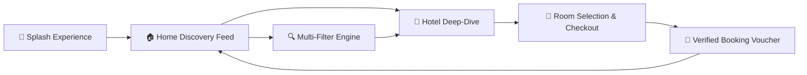

<div align="center">

  

  <br /> <br />

  # ✈️ TravelEase
  ### *Explore • Book • Travel — Next-Generation Travel & Hotel Booking Mobile Experience*

  <p align="center">
    <strong>A high-performance, responsive cross-platform travel discovery and booking mobile application crafted with Flutter 3 and Material Design 3.</strong>
  </p>

  <p align="center">
    <a href="https://flutter.dev"></a>
    <a href="https://dart.dev"></a>
    <a href="LICENSE"></a>
    
    
    
  </p>

  <p align="center">
    <a href="#-overview">Overview</a> •
    <a href="#-live-video-demo">Live Demo</a> •
    <a href="#-core-features">Features</a> •
    <a href="#-screen-showcase--ux-journey">Screen Showcase</a> •
    <a href="#-design-system--tokens">Design System</a> •
    <a href="#-project-architecture">Architecture</a> •
    <a href="#-getting-started">Getting Started</a> •
    <a href="#-roadmap">Roadmap</a>
  </p>

</div>

---

## 📖 Overview

**TravelEase** redefines mobile travel booking by combining modern Scandinavian neo-minimalism with fluid mobile micro-interactions. Designed for discerning travelers seeking vacation villas, coastal escapes, and mountain retreats, the app bridges discovery and reservation into an effortless single-session workflow.

The user interface features a distinctive brand aesthetic: high-contrast **Electric Lime** (`#C6F52B`) accenting deep **Dark Obsidian** (`#0F172A`) surfaces, soft elevated cards, and intuitive touch targets. Every screen is engineered with modular Flutter widgets, reactive state transitions, and responsive layout constraints for smartphones, tablets, and web.

### 🌟 Brand Pillars
* 📍 **Discover Amazing Places** — Curated global retreats with verified traveler ratings and comprehensive amenities.
* 🛡️ **Safe & Secure Bookings** — End-to-end transparent checkout with immediate reservation reference vouchers.
* ⭐ **Best Prices & Deals** — Exclusive flash sales with real-time countdown tickers and instant price calculations.
* 💙 **Your Journey, Our Priority** — Centralized traveler hub with booking histories, wishlists, and customized preferences.

---

## 🎬 Live Video Demo

Experience TravelEase in motion. Watch the seamless discovery, dynamic multi-attribute filter slider, room selection, and checkout flow in real time.

<div align="center">

  <table>
    <tr>
      <th align="center" width="50%">🎥 Enhanced HD Walkthrough</th>
      <th align="center" width="50%">⚡ Quick Animated Preview</th>
    </tr>
    <tr>
      <td align="center" valign="top">
        <video src="assets/Demo.mp4" controls width="320" style="border-radius: 16px; box-shadow: 0 12px 30px rgba(0,0,0,0.18);">
          Your browser does not support the video tag.
        </video>
        <br /><br />
        <a href="https://github.com/Umesh-369/TravelEase/raw/main/assets/Demo.mp4">
          
        </a>
      </td>
      <td align="center" valign="top">
        
        <br /><br />
        <em>⚡ Real-time 60fps in-app transitions & discovery flow</em>
      </td>
    </tr>
  </table>

</div>

---

## ✨ Core Features



- **🏝️ Curated Accommodations & Exotic Stays**  
  Browse handpicked premium villas, luxury beach resorts, and mountain sanctuaries accompanied by high-resolution multi-photo carousels and authentic traveler ratings.
- **⚡ Real-Time Flash Deals & Countdown Timers**  
  Special promotional offerings discounted up to 50% with an active live ticking countdown timer (`02:45:38`) creating authentic booking momentum.
- **🔍 Advanced Multi-Parameter Search & Discovery**  
  Filter stays smoothly with category pills (*Beach, Mountain, Luxury*), an interactive continuous price range slider (`$50 - $500+`), rating thresholds (*All, 4+, 4.5+, 5★*), facility tags (*Pool, WiFi, Ocean View, Breakfast, Spa*), and proximity distance toggles.
- **🏨 Granular Property & Room Specifications**  
  Detailed property profile featuring room area (`32 m²`), bed configurations (`1 King Bed`), maximum guest capacities, and full facility grids (*Gym, Parking, Restaurant, Spa*).
- **💳 Transparent Pricing & Instant Checkout**  
  Live itemized price calculations combining nightly base rates, room counts, duration, and applicable taxes & fees with zero hidden surprises.
- **🧾 Instant Reservation Confirmation & Receipt Voucher**  
  Generates an interactive booking confirmation card with a unique reservation ID (`#TE123456789`), one-click clipboard copying, and direct route reset to the home feed.
- **👤 Traveler Profile & Dashboard**  
  Personalized account hub tracking total bookings, saved favorites, traveler rating, payment methods, notifications, and security preferences.

---

## 📱 Screen Showcase & UX Journey

| Screen | Key Highlights | Core Components |
| :--- | :--- | :--- |
| **1. Splash Screen** | Full-bleed tropical paradise photography, brand badge, and inviting call to exploration. | Custom fade animation, branded logo widget, start CTA |
| **2. Home Screen** | Personalized greeting (`Hello, Albert 👋`), quick search bar, category filter pills, recommended hotel card, and flash deals carousel. | `SearchBarWidget`, `CategoryChip`, `HotelCard`, `FlashDealCard` |
| **3. Search & Filter Screen** | Granular multi-factor filtering engine with real-time matching counter (`Show 245 Places`). | Continuous price range slider, rating chips, facility checklist |
| **4. Hotel Details Screen** | High-res carousel (`1/5`), price header (`$220/night`), expandable property summary, and complete amenities grid. | PageView carousel, rating badges, facility chips, lime `Book Now` button |
| **5. Booking Screen** | Check-in / check-out dates selector, guest headcount controller, room tier selector, and itemized billing summary. | Date selector chips, counter widget, transparent price breakdown |
| **6. Confirmation Screen** | Celebratory success badge, generated booking reference `#TE123456789`, copy action, and trip summary. | Animated checkmark, copyable voucher card, navigation reset button |
| **7. Profile Screen** | User identity, summary stats (3 Bookings, 2 Favorites, 4.8 Rating), and interactive navigation menus. | Circular avatar, metric stat cards, navigation menu list tiles |

---

## 🎨 Design System & Tokens

TravelEase adheres to a tailored design language optimized for high readability, modern elegance, and smooth touch interactions:

### Color Palette

| Token Name | Hex Code | Swatch | Application |
| :--- | :---: | :---: | :--- |
| **Primary Lime** | `#C6F52B` | `██████` | Primary CTA buttons, active chips, promotional badges |
| **Lime Accent Dark** | `#AEDC1C` | `██████` | Pressed states, active borders, contrast highlights |
| **Dark Obsidian** | `#0F172A` | `██████` | Primary typography, filter buttons, active nav icons |
| **Muted Slate** | `#64748B` | `██████` | Subheadings, secondary labels, inactive nav items |
| **Border Light** | `#E2E8F0` | `██████` | Card borders, dividers, chip outlines |
| **Background Light** | `#F8FAFC` | `██████` | Scaffold canvas background |
| **Surface Card** | `#FFFFFF` | `██████` | Elevated card surfaces, modal sheets |
| **Star Gold** | `#F59E0B` | `██████` | Star rating indicators and review scores |
| **Flash Discount Red** | `#EF4444` | `██████` | Promotional deal tags, countdown timers |

### Elevation & Shadows
- **Card Shadow:** `Offset(0, 6)`, Blur `16px`, Color `rgba(0, 0, 0, 0.06)`
- **Floating Shadow:** `Offset(0, 8)`, Blur `24px`, Color `rgba(0, 0, 0, 0.12)`

---

## 🏗️ Project Architecture

The project follows a clean, decoupled component architecture:

```
travelease/
├── assets/
│   ├── Demo.mp4                  # Full HD app walkthrough video
│   ├── demo_preview.gif          # Optimized animated preview GIF
│   ├── showcase.jpg              # Master multi-screen hero banner
│   └── images/                   # Curated hotel and destination assets
│       ├── bali_exotica.jpg
│       ├── beach_dest.jpg
│       ├── flash_deal_hotel.jpg
│       ├── hotel_room.jpg
│       ├── mountain_dest.jpg
│       ├── profile_avatar.jpg
│       └── splash_resort.jpg
├── lib/
│   ├── main.dart                 # App initialization & onGenerateRoute navigation
│   ├── data/
│   │   └── mock_data.dart        # Seed mock dataset for hotels, deals & facilities
│   ├── models/
│   │   └── hotel_model.dart      # Domain models: Hotel, Room, Review, Amenity
│   ├── screens/
│   │   ├── splash_screen.dart           # Immersive landing screen
│   │   ├── main_navigation_screen.dart  # IndexedStack bottom nav host
│   │   ├── home_screen.dart             # Discovery feed & deals
│   │   ├── search_screen.dart           # Multi-attribute filter & search
│   │   ├── hotel_details_screen.dart    # Property specs & photo slider
│   │   ├── booking_screen.dart          # Dates, room config & billing
│   │   ├── confirmation_screen.dart     # Reservation voucher & booking code
│   │   └── profile_screen.dart          # Traveler profile & preferences
│   ├── theme/
│   │   └── app_theme.dart        # Design tokens, palette, ThemeData
│   └── widgets/
│       ├── category_chip.dart    # Pill category filter widget
│       ├── custom_bottom_nav.dart# Floating curved navigation bar
│       ├── custom_button.dart    # Electric lime and dark CTA buttons
│       ├── flash_deal_card.dart  # Deal card with live countdown
│       ├── hotel_card.dart       # Recommendation & search card
│       └── search_bar.dart       # Search bar with filter action trigger
└── pubspec.yaml                  # Flutter dependencies & asset manifest
```

---

## 🚀 Getting Started

### Prerequisites

Ensure you have the following installed on your development workstation:
* [Flutter SDK](https://docs.flutter.dev/get-started/install) (`>=3.12.2`)
* [Dart SDK](https://dart.dev/get-dart)
* [Android Studio](https://developer.android.com/studio) / [VS Code](https://code.visualstudio.com/) with the Flutter extension
* Android Emulator / iOS Simulator / Physical device

### Installation & Run

1. **Clone the repository:**
   ```bash
   git clone https://github.com/Umesh-369/TravelEase.git
   cd TravelEase
   ```

2. **Install Flutter dependencies:**
   ```bash
   flutter pub get
   ```

3. **Verify environment health:**
   ```bash
   flutter doctor
   ```

4. **Launch the app:**
   ```bash
   # Launch on any connected default device
   flutter run

   # Or target specific platforms
   flutter run -d chrome        # Web preview
   flutter run -d android       # Android device/emulator
   flutter run -d ios           # iOS simulator/device
   ```

---

## 🧪 Testing & Code Quality

Run tests and static analysis:

```bash
# Run widget and unit tests
flutter test

# Run Dart static analyzer
flutter analyze
```

---

## 🗺️ Roadmap

- [x] Immersive Splash screen with brand identity
- [x] Dynamic Home feed with categories and flash sales
- [x] Multi-parameter search with price slider & facility chips
- [x] Hotel details with image carousels & amenities
- [x] Room tier selection and transparent billing summary
- [x] Instant booking confirmation with reference voucher
- [x] Traveler profile dashboard and metrics
- [ ] Integration with live Hotel & Booking APIs (Amadeus / Booking.com)
- [ ] Payment gateway integration (Stripe, Apple Pay, Google Pay)
- [ ] Flights and car rentals booking engine
- [ ] Dark theme mode with automatic system toggle
- [ ] Multi-currency and multi-language localization (i18n)

---

## 🤝 Contributing

Contributions, issues, and feature requests are welcome!

1. Fork the Project
2. Create your Feature Branch (`git checkout -b feature/AmazingFeature`)
3. Commit your Changes (`git commit -m 'feat: add some AmazingFeature'`)
4. Push to the Branch (`git push origin feature/AmazingFeature`)
5. Open a Pull Request

---

## 📄 License

Distributed under the **MIT License**. See [`LICENSE`](LICENSE) for complete details.

---

<div align="center">

  Crafted with ❤️ by **[Umesh Sai Hanuma Prasad Syamala](https://github.com/Umesh-369)**

  *Travel Dreams Made Real ✈*

</div>